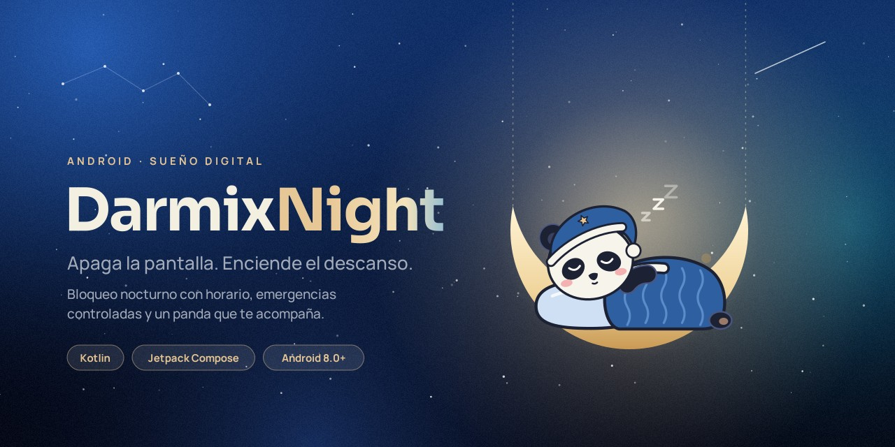
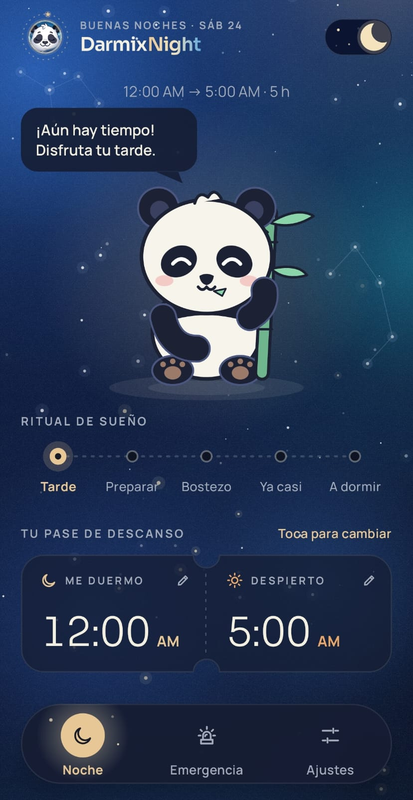
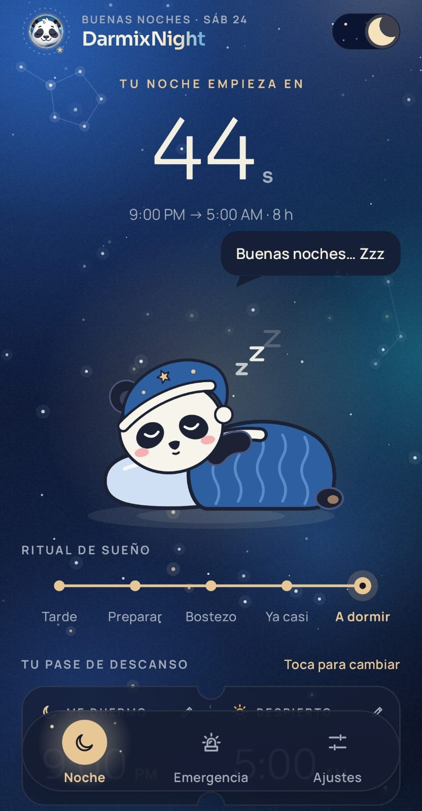
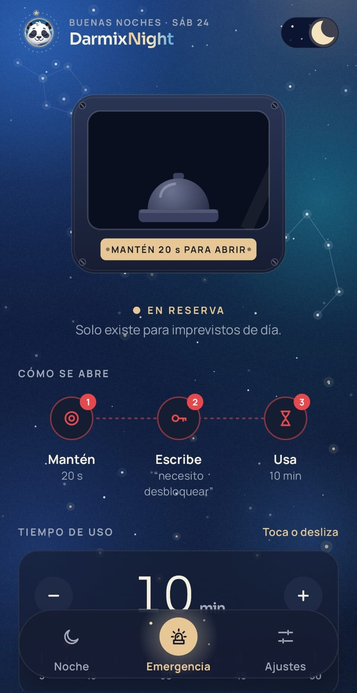
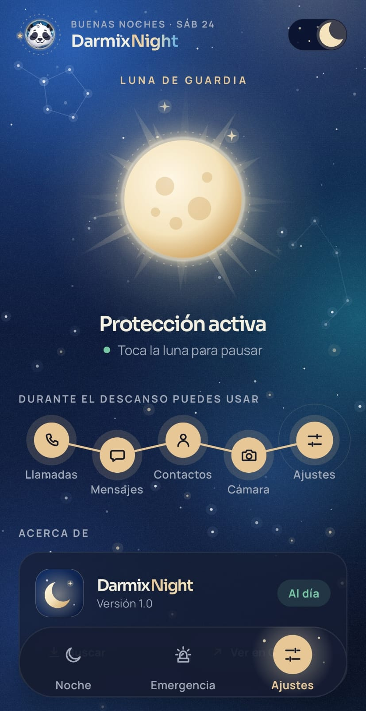
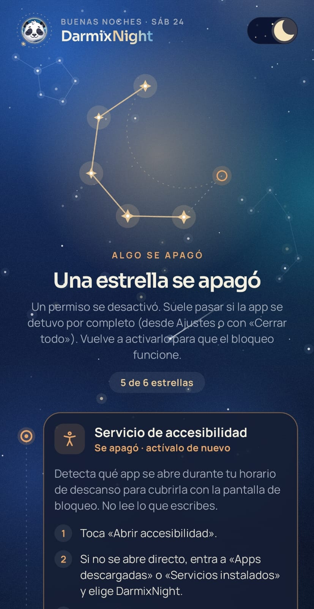
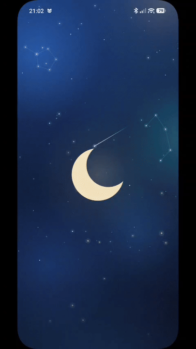
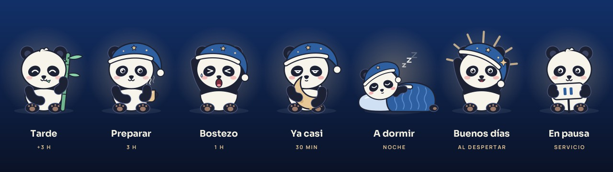
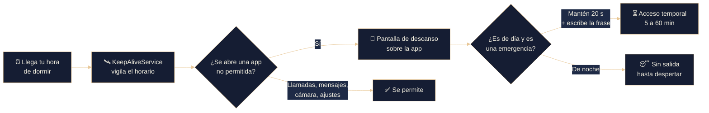

<div align="center">

<picture>
  <source media="(prefers-color-scheme: dark)" srcset="docs/assets/banner-dark.jpg">
  <source media="(prefers-color-scheme: light)" srcset="docs/assets/banner-light.jpg">
  
</picture>

<h3>Apaga la pantalla. Enciende el descanso.</h3>

<p>
  <a href="https://github.com/OrlandoGalvanVargas/darmixnight/releases/latest"></a>
  <a href="https://github.com/OrlandoGalvanVargas/darmixnight/releases"></a>
  
  
  
  <a href="LICENSE"></a>
</p>

<p>
  <a href="#qué-es-darmixnight">Qué es</a> ·
  <a href="#capturas">Capturas</a> ·
  <a href="#características">Características</a> ·
  <a href="#instalación">Instalación</a> ·
  <a href="#cómo-funciona">Cómo funciona</a> ·
  <a href="#stack-técnico">Stack</a> ·
  <a href="#compilar-desde-el-código">Compilar</a> ·
  <a href="https://darmixista.dev/darmixnight">Página oficial</a>
</p>

<a href="https://github.com/OrlandoGalvanVargas/darmixnight/releases/latest">
  
</a>
&nbsp;
<a href="https://darmixista.dev/darmixnight">
  
</a>

</div>

<br>

## Qué es DarmixNight

**DarmixNight** es una app para Android que bloquea tu teléfono durante tu horario de descanso. A la hora que elijas, cualquier app que abras queda cubierta por una pantalla de descanso hasta la mañana, para que el «solo un video más» deje de robarte horas de sueño.

No es un modo «No molestar» que se apaga con un toque: el bloqueo es firme, la única salida es un desbloqueo de emergencia que solo existe de día, y todo está acompañado por un panda que cambia según lo cerca que estés de dormir.

> [!NOTE]
> DarmixNight se distribuye únicamente desde [GitHub Releases](https://github.com/OrlandoGalvanVargas/darmixnight/releases) y su página oficial, [darmixista.dev/darmixnight](https://darmixista.dev/darmixnight). Funciona sin cuentas ni servidores: tu horario y tu uso nunca salen del teléfono.

## Capturas

<div align="center">
<table>
  <tr>
    <td align="center"></td>
    <td align="center"></td>
    <td align="center"></td>
  </tr>
  <tr>
    <td align="center"><b>Noche</b><br><sub>Cuenta regresiva, ritual de sueño y pase de descanso</sub></td>
    <td align="center"><b>Bloqueo</b><br><sub>El panda duerme en su luna mientras tú descansas</sub></td>
    <td align="center"><b>Emergencia</b><br><sub>Una salida controlada, solo de día</sub></td>
  </tr>
  <tr>
    <td align="center"></td>
    <td align="center"></td>
    <td align="center"></td>
  </tr>
  <tr>
    <td align="center"><b>Ajustes</b><br><sub>La luna de guardia pausa o reactiva el servicio</sub></td>
    <td align="center"><b>Permisos</b><br><sub>Cada permiso enciende una estrella</sub></td>
    <td align="center"><b>Inicio</b><br><sub>La luna se vuelve cuna</sub></td>
  </tr>
</table>
</div>

## Características

- 🌙 **Bloqueo automático por horario.** Eliges a qué hora te duermes y a qué hora despiertas; el resto lo hace la app, incluso con la pantalla apagada o tras reiniciar.
- 🐼 **Un panda que vive tu noche.** Come bambú en la tarde, se pone el gorro, bosteza, abraza su luna y se duerme contigo. Reacciona cuando lo tocas o lo acaricias.
- 🚨 **Emergencias con fricción.** De día puedes salir manteniendo presionado 20 segundos y escribiendo una frase. De noche no hay salida.
- 📞 **Lo esencial sigue funcionando.** Llamadas, mensajes, contactos, cámara y ajustes nunca se bloquean.
- ⏸️ **Pausa consciente.** Toca la luna de guardia para tomarte una noche libre; no se puede pausar en pleno descanso.
- 🎨 **Diseño propio de principio a fin.** Cielo animado, tema claro y oscuro, ilustraciones dibujadas en código y transiciones con identidad.
- 🔄 **Actualizaciones dentro de la app.** Detecta nuevas versiones en GitHub, descarga el APK y abre el instalador de Android.
- 🔒 **Privada por diseño.** Sin cuentas, sin analíticas, sin servidores propios.

<div align="center">
  
  <sub>El panda cambia solo según cuánto falta para tu hora de dormir.</sub>
</div>

## Instalación

1. Descarga el archivo `.apk` de la [última versión](https://github.com/OrlandoGalvanVargas/darmixnight/releases/latest) o desde la [página oficial](https://darmixista.dev/darmixnight).
2. Ábrelo en tu teléfono y, si Android lo pide, permite instalar apps de ese origen.
3. Abre DarmixNight y sigue la pantalla de permisos: la app te guía paso a paso y enciende una estrella por cada permiso.
4. Elige tu horario en la pestaña **Noche**. Listo.

> [!IMPORTANT]
> En Android 13 o superior, las apps instaladas desde un APK necesitan que autorices los **ajustes restringidos** antes de activar la accesibilidad. La app te muestra cómo hacerlo como primer paso.

<details>
<summary><b>Teléfonos Xiaomi, Redmi y POCO (HyperOS / MIUI)</b></summary>
<br>

Estos sistemas cierran apps en segundo plano por su cuenta. Para que el bloqueo no falle una noche:

- Activa **Inicio automático** para DarmixNight (la app abre la pantalla correcta).
- En Recientes, mantén presionada la tarjeta de DarmixNight y toca el **candado**, así «Cerrar todo» no la detiene.

</details>

<details>
<summary><b>Permisos que usa y para qué</b></summary>
<br>

| Permiso | Para qué se usa |
|---|---|
| Servicio de accesibilidad | Detectar qué app se abre durante tu horario para cubrirla. No lee lo que escribes ni el contenido de la pantalla. |
| Mostrar sobre otras apps | Dibujar la pantalla de descanso encima de cualquier app. |
| Notificaciones | Mostrar el aviso permanente que mantiene el servicio activo toda la noche. |
| Sin restricciones de batería | Evitar que Android detenga la app de madrugada para ahorrar energía. |
| Alarmas exactas | Empezar y terminar el bloqueo en el minuto exacto que elegiste. |
| Inicio al arrancar | Volver a activarse solo después de reiniciar el teléfono. |
| Internet e instalar apps | Únicamente para buscar y descargar actualizaciones desde GitHub. |

</details>

## Cómo funciona



- **`BlockAccessibilityService`** detecta la app en primer plano y decide si debe cubrirse.
- **`OverlayManager`** dibuja la pantalla de descanso con Compose en una ventana superpuesta.
- **`KeepAliveService`** mantiene el servicio en primer plano, actualiza la notificación al instante y reprograma su vigilancia.
- **`WatchdogReceiver`** y **`BootReceiver`** reviven el servicio si el sistema lo detiene o el teléfono se reinicia.
- **`UpdateManager`** consulta GitHub Releases, descarga el APK y lanza la instalación con `PackageInstaller`.

## Stack técnico

| Área | Tecnología |
|---|---|
| Lenguaje | Kotlin 2.2 |
| UI | Jetpack Compose, Material 3, animaciones y dibujo en `Canvas` |
| Persistencia | DataStore Preferences, SharedPreferences |
| Sistema | AccessibilityService, `WindowManager` overlays, Foreground Service, AlarmManager, `PackageInstaller` |
| Arranque | SplashScreen API con intro animada en Compose |
| Build | Android Gradle Plugin 9, Version Catalogs |
| SDK | `minSdk 26` · `targetSdk 37` |

<details>
<summary><b>Estructura del proyecto</b></summary>
<br>

```text
app/src/main/java/com/darmix/darmixnight
├── BlockAccessibilityService.kt   Detección de la app en primer plano
├── OverlayManager.kt              Ventana de bloqueo superpuesta
├── KeepAliveService.kt            Servicio en primer plano y notificación
├── EmergencyUnlockManager.kt      Desbloqueo temporal y registro semanal
├── BlockPrefs.kt · SetupPrefs.kt  Preferencias del usuario
├── ScheduleUtils.kt               Reglas de horario y ventana de emergencia
├── BootReceiver.kt · WatchdogReceiver.kt
├── update/                        Actualizador desde GitHub Releases
└── ui/
    ├── splash/        Intro «La luna se vuelve cuna»
    ├── permissions/   Constelación de permisos
    ├── main/          Encabezado, barra lunar, guía de bienvenida
    │   ├── night/        Pestaña Noche
    │   ├── emergency/    Pestaña Emergencia
    │   └── settings/     Pestaña Ajustes
    ├── block/         Pantalla de descanso
    ├── panda/         El panda y sus momentos, dibujados en código
    ├── components/    Cielo animado, glifos, botones, constelaciones
    ├── update/        Diálogo de actualización
    └── theme/         Paleta, tipografía (Sora y Manrope) y tema
```

</details>

## Compilar desde el código

**Requisitos:** Android Studio reciente con JDK 17 o superior y el SDK de Android 37.

```bash
git clone https://github.com/OrlandoGalvanVargas/darmixnight.git
cd darmixnight
./gradlew assembleDebug
```

El APK queda en `app/build/outputs/apk/debug/`. Para instalarlo directo en un teléfono conectado:

```bash
./gradlew installDebug
```

<details>
<summary><b>Publicar una nueva versión</b></summary>
<br>

El actualizador de la app compara la etiqueta del release con la versión instalada, así que el proceso importa:

1. Sube `versionCode` y `versionName` en `app/build.gradle.kts`.
2. Genera el APK de release **firmado siempre con la misma llave**.
3. Crea un release con la etiqueta `v` + `versionName` (por ejemplo `v1.1`).
4. Adjunta el archivo `.apk` y escribe las novedades como lista con `-`: la app las muestra en el diálogo de actualización.
5. No lo marques como pre-release: el actualizador las ignora.

</details>

<details>
<summary><b>Limitaciones conocidas</b></summary>
<br>

- Si alguien usa **Forzar detención** desde los ajustes de Android, el sistema desactiva la accesibilidad y ninguna app puede recuperarse sola. DarmixNight lo detecta al abrirse y te pide reactivarla.
- Los ajustes del sistema se mantienen accesibles durante el descanso por seguridad, así que la app no puede impedir que alguien desactive la accesibilidad desde ahí.

</details>

## Privacidad

DarmixNight no recopila datos. No hay cuentas, analíticas ni servidores propios. La única conexión a internet consulta los releases públicos de este repositorio para buscar actualizaciones. El servicio de accesibilidad solo lee el nombre del paquete de la app en primer plano; nunca el contenido de la pantalla ni lo que escribes.

## Página oficial

Conoce más de DarmixNight, sus novedades y su historia en **[darmixista.dev/darmixnight](https://darmixista.dev/darmixnight)**.

## Licencia

Distribuido bajo la licencia MIT. Consulta [`LICENSE`](LICENSE) para más detalles.

## Autor

<table>
  <tr>
    <td>
      <b>Orlando Galván Vargas</b> · <i>Darmix</i><br>
      Desarrollador de software fullstack.<br>
      <a href="https://darmixista.dev">darmixista.dev</a> ·
      <a href="https://www.linkedin.com/in/orlandogalvan-dev">LinkedIn</a> ·
      <a href="https://github.com/OrlandoGalvanVargas">GitHub</a>
    </td>
  </tr>
</table>

<div align="center">
<br>
<sub>Hecho con 🌙 y mucho sueño pendiente en México.</sub>
</div>
