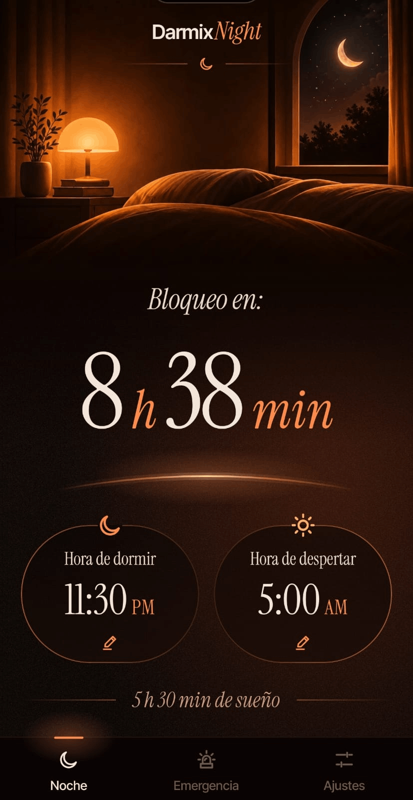
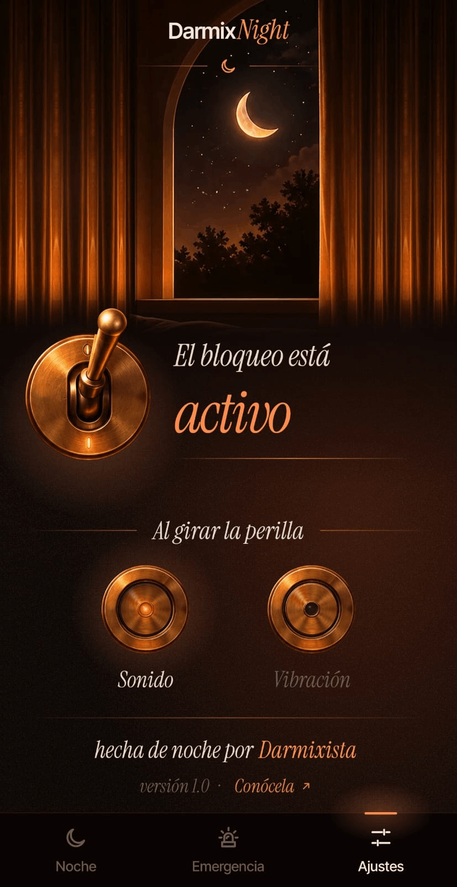
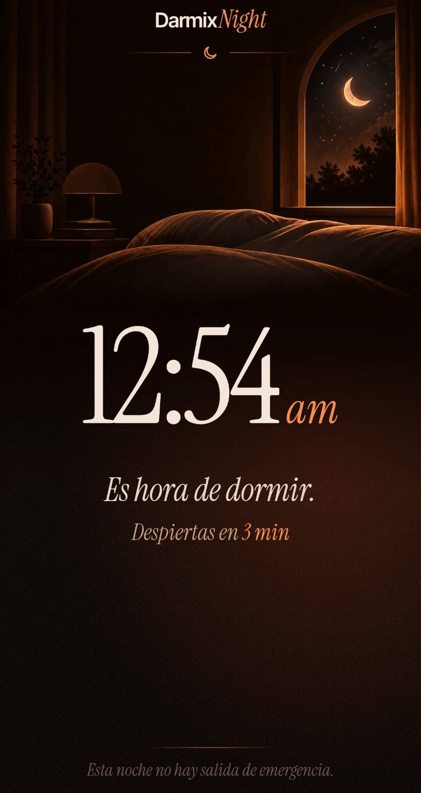
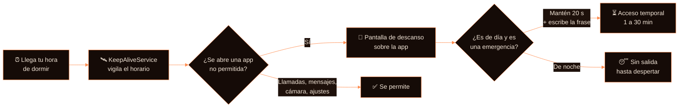

<div align="center">


<h3>Apaga la pantalla. Enciende el descanso.</h3>

<p>
  <a href="https://github.com/OrlandoGalvanVargas/darmixnight/releases/latest"></a>
  <a href="https://github.com/OrlandoGalvanVargas/darmixnight/releases"></a>
  
  
  
  <a href="LICENSE"></a>
</p>

<p>
  <a href="#qué-es-darmixnight">Qué es</a> ·
  <a href="#capturas">Capturas</a> ·
  <a href="#características">Características</a> ·
  <a href="#instalación">Instalación</a> ·
  <a href="#cómo-funciona">Cómo funciona</a> ·
  <a href="#stack-técnico">Stack</a> ·
  <a href="#compilar-desde-el-código">Compilar</a> ·
  <a href="https://darmixista.dev/darmixnight">Página oficial</a>
</p>

<a href="https://github.com/OrlandoGalvanVargas/darmixnight/releases/latest">
  
</a>
&nbsp;
<a href="https://darmixista.dev/darmixnight">
  
</a>

</div>

<br>

## Qué es DarmixNight

**DarmixNight** es una app para Android que bloquea tu teléfono durante tu horario de descanso. A la hora que elijas, cualquier app que abras queda cubierta por una pantalla de descanso hasta la mañana, para que el «solo un video más» deje de robarte horas de sueño.

No es un modo «No molestar» que se apaga con un toque: el bloqueo es firme y la única salida es un desbloqueo de emergencia con fricción. Toda la app vive dentro de una misma habitación nocturna ilustrada que cambia contigo: la lámpara encendida mientras esperas la hora de dormir, solo la luz de la luna durante el bloqueo y la luna apagada cuando pausas el servicio.

> [!NOTE]
> DarmixNight se distribuye únicamente desde [GitHub Releases](https://github.com/OrlandoGalvanVargas/darmixnight/releases) y su página oficial, [darmixista.dev/darmixnight](https://darmixista.dev/darmixnight). Funciona sin cuentas ni servidores: tu horario y tu uso nunca salen del teléfono.

## Capturas

<div align="center">
<table>
  <tr>
    <td align="center"></td>
    <td align="center"></td>
    <td align="center"></td>
  </tr>
  <tr>
    <td align="center"><b>Noche</b><br><sub>La cuenta regresiva y tus horarios</sub></td>
    <td align="center"><b>Emergencia</b><br><sub>Una perilla de cocina para el tiempo de salida</sub></td>
    <td align="center"><b>Ajustes</b><br><sub>Una palanca de latón enciende o pausa el bloqueo</sub></td>
  </tr>
  <tr>
    <td align="center"></td>
    <td align="center"></td>
    <td align="center"></td>
  </tr>
  <tr>
    <td align="center"><b>Bloqueo</b><br><sub>La habitación ya duerme</sub></td>
    <td align="center"><b>Permisos</b><br><sub>Un objeto del buró por cada permiso</sub></td>
    <td align="center"><b>Inicio</b><br><sub>La lámpara se apaga</sub></td>
  </tr>
</table>
</div>

## Características

- 🌙 **Bloqueo automático por horario.** Eliges a qué hora te duermes y a qué hora despiertas; el resto lo hace la app, incluso con la pantalla apagada o tras reiniciar.
- 🛏️ **Una habitación que vive tu noche.** Ilustraciones animadas en código: la lámpara respira, la planta se mece, las estrellas parpadean y cruzan estrellas fugaces. Cada estado del servicio se ve en la escena, sin etiquetas.
- ⏳ **Emergencias con fricción.** De día puedes salir manteniendo presionado 20 segundos y escribiendo una frase, por un tiempo de 1 a 30 minutos que eliges con una perilla. De noche no hay salida.
- 🔩 **Controles físicos.** Una perilla de cobre, una palanca y botones de latón, con sonidos mecánicos propios y vibración que puedes desactivar.
- 🗝️ **Permisos uno por uno.** Cada permiso es un objeto sobre el buró, con su explicación y un acceso directo a los ajustes de Android. Detecta solo los que tu teléfono necesita.
- 📞 **Lo esencial sigue funcionando.** Llamadas, mensajes, contactos, cámara y ajustes nunca se bloquean.
- ⏸️ **Pausa consciente.** Pausa el servicio cuando quieras tomarte una noche libre; no se puede pausar en pleno descanso.
- 🔄 **Actualizaciones dentro de la app.** Detecta nuevas versiones en GitHub, descarga el APK y abre el instalador de Android.
- 🔒 **Privada por diseño.** Sin cuentas, sin analíticas, sin servidores propios.

## Instalación

1. Descarga el archivo `.apk` de la [última versión](https://github.com/OrlandoGalvanVargas/darmixnight/releases/latest) o desde la [página oficial](https://darmixista.dev/darmixnight).
2. Ábrelo en tu teléfono y, si Android lo pide, permite instalar apps de ese origen.
3. Abre DarmixNight y sigue los permisos: la app te muestra uno a la vez y avanza sola cuando lo activas.
4. Elige tu horario en la pestaña **Noche**. Listo.

> [!IMPORTANT]
> En Android 13 o superior, las apps instaladas desde un APK necesitan que autorices los **ajustes restringidos** antes de activar la accesibilidad. La app te guía en los dos pasos: primero tocar DarmixNight en Accesibilidad y luego activar «Permitir ajustes restringidos» desde la información de la app.

<details>
<summary><b>Teléfonos Xiaomi, Redmi y POCO (HyperOS / MIUI)</b></summary>
<br>

Estos sistemas cierran apps en segundo plano por su cuenta. Para que el bloqueo no falle una noche:

- Activa **Inicio automático** para DarmixNight (la app abre la pantalla correcta).
- En Recientes, mantén presionada la tarjeta de DarmixNight y toca el **candado**, así «Cerrar todo» no la detiene.

</details>

<details>
<summary><b>Permisos que usa y para qué</b></summary>
<br>

| Permiso | Para qué se usa |
|---|---|
| Servicio de accesibilidad | Detectar qué app se abre durante tu horario para cubrirla. No lee lo que escribes ni el contenido de la pantalla. |
| Mostrar sobre otras apps | Dibujar la pantalla de descanso encima de cualquier app. |
| Notificaciones | Mostrar el aviso permanente que mantiene el servicio activo toda la noche. |
| Sin restricciones de batería | Evitar que Android detenga la app de madrugada para ahorrar energía. |
| Alarmas exactas | Empezar y terminar el bloqueo en el minuto exacto que elegiste. |
| Inicio al arrancar | Volver a activarse solo después de reiniciar el teléfono. |
| Internet e instalar apps | Únicamente para buscar y descargar actualizaciones desde GitHub. |

</details>

## Cómo funciona



- **`BlockAccessibilityService`** detecta la app en primer plano y decide si debe cubrirse.
- **`OverlayManager`** dibuja la pantalla de descanso con Compose en una ventana superpuesta.
- **`KeepAliveService`** mantiene el servicio en primer plano, actualiza la notificación al instante y reprograma su vigilancia.
- **`WatchdogReceiver`** y **`BootReceiver`** reviven el servicio si el sistema lo detiene o el teléfono se reinicia.
- **`UpdateManager`** consulta GitHub Releases, descarga el APK y lanza la instalación con `PackageInstaller`.

## Stack técnico

| Área | Tecnología |
|---|---|
| Lenguaje | Kotlin 2.2 |
| UI | Jetpack Compose, Material 3, dibujo en `Canvas` sobre ilustraciones WebP |
| Animación | Reloj de escena compartido, `RuntimeShader` (AGSL) para el balanceo de la planta y los árboles en Android 13+ |
| Sonido | `SoundPool` con efectos mecánicos sintetizados |
| Persistencia | DataStore Preferences, SharedPreferences |
| Sistema | AccessibilityService, `WindowManager` overlays, Foreground Service, AlarmManager, `PackageInstaller` |
| Arranque | SplashScreen API con intro animada en Compose |
| Build | Android Gradle Plugin 9, Version Catalogs |
| SDK | `minSdk 26` · `targetSdk 37` |

<details>
<summary><b>Estructura del proyecto</b></summary>
<br>

```text
app/src/main/java/com/darmix/darmixnight
├── BlockAccessibilityService.kt   Detección de la app en primer plano
├── OverlayManager.kt              Ventana de bloqueo superpuesta
├── KeepAliveService.kt            Servicio en primer plano y notificación
├── EmergencyUnlockManager.kt      Desbloqueo temporal y registro de usos
├── BlockPrefs.kt · SetupPrefs.kt  Preferencias del usuario
├── PermissionUtils.kt             Estado de permisos y ajustes restringidos
├── ScheduleUtils.kt               Reglas de horario y ventana de emergencia
├── BootReceiver.kt · WatchdogReceiver.kt
├── update/                        Actualizador desde GitHub Releases
└── ui/
    ├── splash/        Intro «La lámpara se apaga»
    ├── permissions/   Permisos uno por uno sobre el buró
    ├── main/          Encabezado, barra de navegación, selector de horas
    │   ├── night/        Pestaña Noche y su habitación
    │   ├── emergency/    Pestaña Emergencia, reloj de arena y perilla
    │   └── settings/     Pestaña Ajustes, ventana y controles de latón
    ├── block/         Pantalla de descanso
    ├── components/    Kit de escenas, cielo, glifos, botones y sonidos
    ├── update/        Diálogo de actualización
    └── theme/         Paleta Brasa, tipografía (Instrument Serif e Inter Tight) y tema
```

</details>

## Compilar desde el código

**Requisitos:** Android Studio reciente con JDK 17 o superior y el SDK de Android 37.

```bash
git clone https://github.com/OrlandoGalvanVargas/darmixnight.git
cd darmixnight
./gradlew assembleDebug
```

El APK queda en `app/build/outputs/apk/debug/`. Para instalarlo directo en un teléfono conectado:

```bash
./gradlew installDebug
```

<details>
<summary><b>Publicar una nueva versión</b></summary>
<br>

El actualizador de la app compara la etiqueta del release con la versión instalada, así que el proceso importa:

1. Sube `versionCode` y `versionName` en `app/build.gradle.kts`.
2. Genera el APK de release **firmado siempre con la misma llave**.
3. Crea un release con la etiqueta `v` + `versionName` (por ejemplo `v2.0`).
4. Adjunta el archivo `.apk` y escribe las novedades como lista con `-`: la app las muestra en el diálogo de actualización.
5. No lo marques como pre-release: el actualizador las ignora.

</details>

<details>
<summary><b>Limitaciones conocidas</b></summary>
<br>

- Si alguien usa **Forzar detención** desde los ajustes de Android, el sistema desactiva la accesibilidad y ninguna app puede recuperarse sola. DarmixNight lo detecta al abrirse y te pide reactivarla.
- Los ajustes del sistema se mantienen accesibles durante el descanso por seguridad, así que la app no puede impedir que alguien desactive la accesibilidad desde ahí.
- El balanceo de la planta y de los árboles requiere Android 13 o superior; en versiones anteriores esa parte de la escena queda quieta.

</details>

## Privacidad

DarmixNight no recopila datos. No hay cuentas, analíticas ni servidores propios. La única conexión a internet consulta los releases públicos de este repositorio para buscar actualizaciones. El servicio de accesibilidad solo lee el nombre del paquete de la app en primer plano; nunca el contenido de la pantalla ni lo que escribes.

## Página oficial

Conoce más de DarmixNight, sus novedades y su historia en **[darmixista.dev/darmixnight](https://darmixista.dev/darmixnight)**.

## Licencia

Distribuido bajo la licencia MIT. Consulta [`LICENSE`](LICENSE) para más detalles.

## Autor

<table>
  <tr>
    <td>
      <b>Orlando Galván Vargas</b> · <i>Darmix</i><br>
      Desarrollador de software fullstack.<br>
      <a href="https://darmixista.dev">darmixista.dev</a> ·
      <a href="https://www.linkedin.com/in/orlandogalvan-dev">LinkedIn</a> ·
      <a href="https://github.com/OrlandoGalvanVargas">GitHub</a>
    </td>
  </tr>
</table>

<div align="center">
<br>
<sub>Hecho de noche, con 🌙 y mucho sueño pendiente, en México.</sub>
</div>
